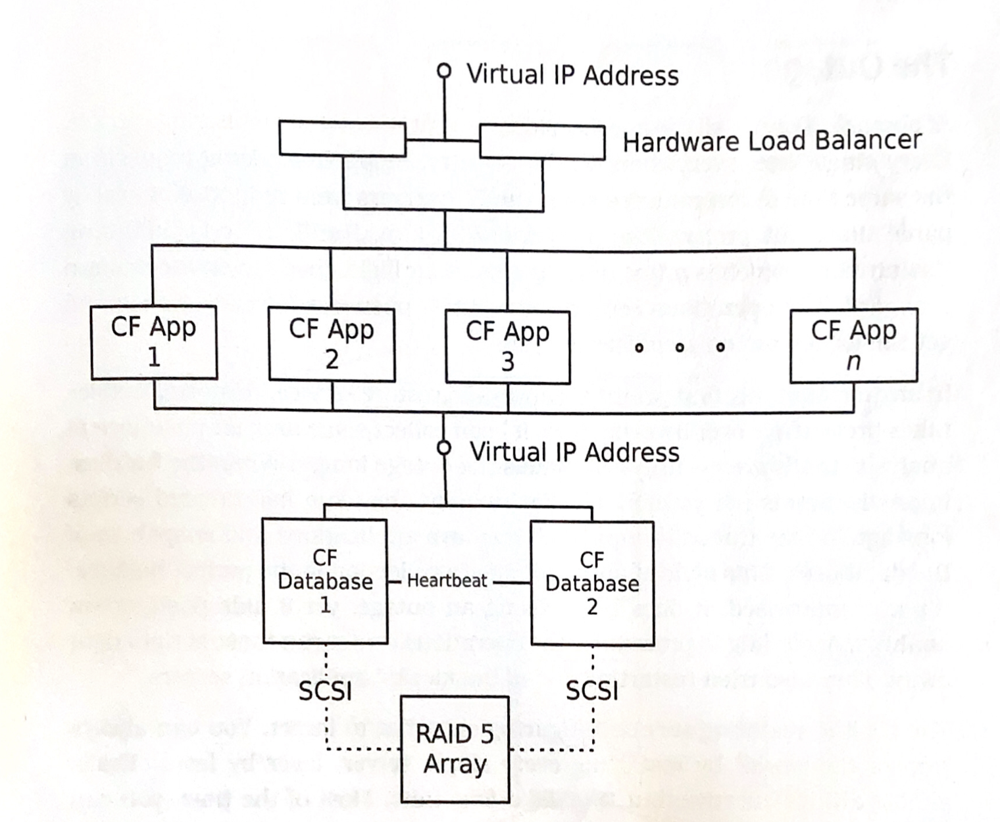
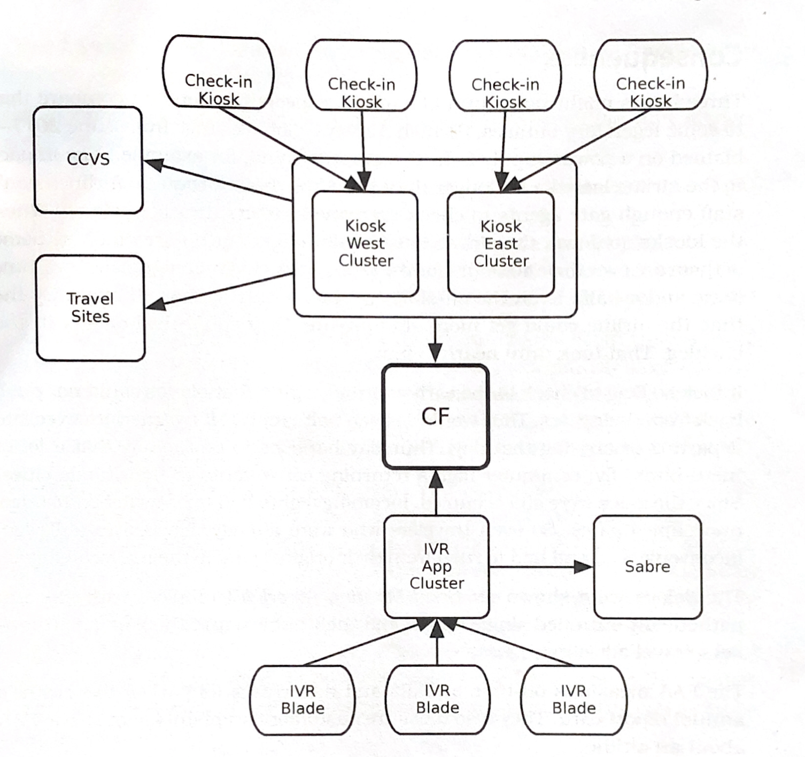
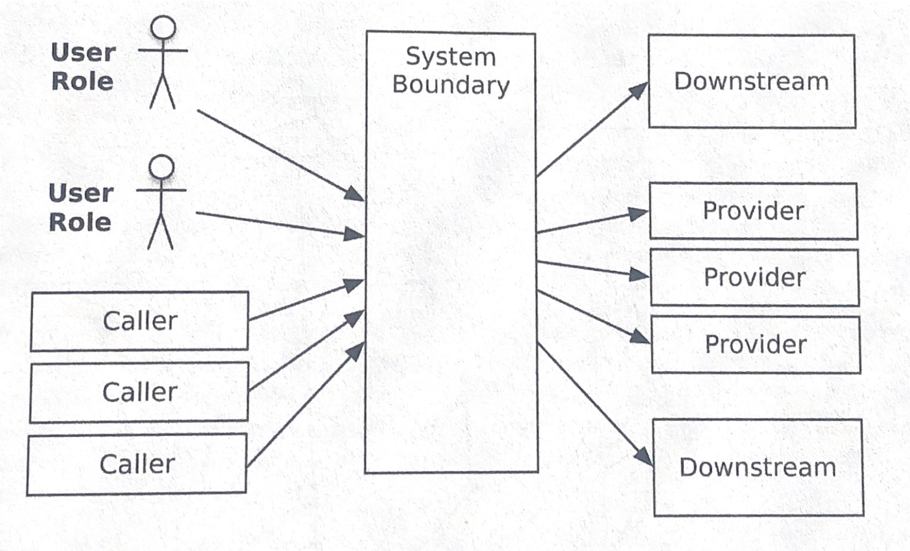
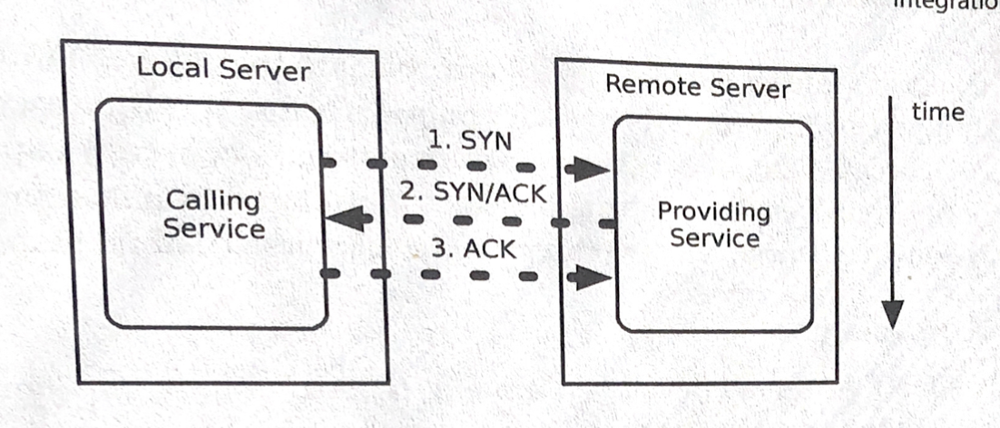

**How this book is organized?**

This book is divided into four parts, each introduced by a case study and followed by the processes involved in fixing the issues that arise.

Part 1: "Create Stability", is about keeping your systems alive, maintaining system uptime. Stability is a necessary prerequisite to any other concerns.

Part 2: "Design for Production", you will learn about the complexity of modern production environments. This part should illustrate to you good patterns for control, transparency and availability in data centers and cloud environments.

Part 3: "Deliver Your System", you'll begin to look at deployments, in order to solve the challenge of pushing small changes without breaking consumers, "zero-down" deployments. This chapter also highlights versioning your software across disparate services.

Part 4: "Solve Systemic Problems", you'll start to observe the ongoing life of your system as part of the overall information ecosystem. You'll learn how to build your systems so that they grow, flex and adapt over time with concepts like evolutionary architecture and shared "knowledge" across systems. There will also be sections about designing _Antifragile_ systems through the emerging discipline of "chaos engineering" that uses randomness and deliberate stress on a system to improve it.

## Living in Production

> We end up falling behind on the new system because we're constantly taking support calls from the last half-baked project we shoved out the door.

### Key Points

1. Aim for the right target
   1. When we build software that passes through QA, we make the assumption and say with confidence that it's ready for production. Passing QA does not mean this, it does not give us a look at our software over a long timespan—three to five years—nor does it tell us how well it will handle users.
2. The scope of the challenge
   1. This challenge has gotten much harder, you used to be able to measure a software project's user base in tens or hundreds with only a few concurrent users. Now we have seen our first billion-user software product (Facebook) and it isn't the last.
   2. Our software needs to be available "24 by 7 by 52", designs appropriate for small WordPress sites fail outrageously when applied to large scale, transactional, distributed systems.
3. What's on the line
   1. The success of a project will determine a company's stock options or profit sharing, a company's survival, and even your job. Systems built for QA often require much ongoing expense.
   2. Design and architecture decisions are also financial decisions. Make them with an eye towards the future, focusing on their implementation and downstream costs.
4. These early design decisions make the biggest impact on the eventual shape of your system. The earliest decisions you make can be the hardest ones to reverse later.

## Pragmatic Architecture

Two distinct activities full under the term _architecture._ One type of architecture strives towards higher levels of abstraction that are more portable across platforms and less connected to the messy details of hardware and networks. The other type strives towards a one size fits all choice in tooling, not allowing for freedom in choice of how to solve a problem, and teams led by those with an "Ivory Tower" mindset.

### Part One: Create Stability

Part one opens with a case study following an airline's decision to move to a [service-oriented architecture](https://en.wikipedia.org/wiki/Service-oriented_architecture), the outage that occurred during a planned failover of the database server that served their Core Facilities—flight searches, check-in kiosks, phone menus, and "channel partner" applications—it was meant to be rolled out in phases, driven by features.

#### The Current Architecture

The CF application ran on a cluster of J2EE applications servers with a redundant Oracle 9i database, all data was stored on a large external RAID array with twice-daily, off-site backups on tape and on disk replicas in a second chassis which were five minutes old at most.



This diagram depicts a high-availability architecture for physical infrastructure. CF did not did not suffer from any single-point-of-failure problems.

## Case Study: The Exception That Grounded an Airline

The failover was scheduled for a Thursday evening around 11 p.m. Pacific time. Everything went exactly as planned, migrate the active database from database 1 to database 2 and then upgrade database 1. After double-checking that database 1 had been updated they made it the active database and applied the updates to database 2. Site monitoring show that the applications were continuously available.

At 12:30 in the morning, after a 22-hour shift, the architecture team marked the project as **Complete** and signed off. Two hours later, all the check-in kiosks went red on the monitoring console.

### After an Outage

The first priority after an outage should always be to restore services, the trick is figuring out what to target; You can either:

- "Reboot the World"; restarting every single server, layer by layer.

  **Or**

- You can find the one culprit locking things up. Look for symptoms to diagnose the whole problem.

  In this case, the team was facing two separate sets of applications that were both completely hung. The team's hypothesis was that both of the applications depended on a third entity that was in trouble.

  The team decided to restart each of the CF application servers, this restored services to the IVR systems but the kiosks still showed red. Luckily, restarting the kiosk's own application servers did the trick.

  **Time to Solve: Three Hours.**



Dependency Diagram, the only common dependency between the kiosks and the IVR app cluster was Core Facilities.

#### Consequences

The delays this outage cause were on _Good Morning America,_ the rating given to the airline by the FAA (Federal Aviation Administration) was affected, and [luckily,] the CEO's compensation was affected.

#### Postmortem

Conducting a post mortem investigation of an outage involves asking questions; in this case those questions were:

- Did the database failover cause the outage?
- Was the cluster configured correctly?
- Did the operations team conduct the maintenance correctly?
- How could the failure have been detected before the outage occured?
- Most importantly, how do we make sure this never, ever happens again?

#### Use Your Tools

- Gather log files, thread dumps and configuration files for all systems involved.
- Once you have these make sure to make comparisons between the files before and after the outage.

**Now, let's hunt for clues,** using the log files we can start to look for common problems between the server cluster: not enough heartbeats, heartbeats going through switches that carry production traffic, servers set up to use the local IP address instead of a virtual IP address, bad dependencies among managed packages, and so on.

##### Reading a Thread Dump

You can deduce a great deal about a problem in an applications with the thread dump:

1. Ask it questions
   1. What third-party libraries the application uses
   2. What kind of thread pools it has
   3. How many threads are in each
   4. What background processing the application uses
   5. What protocols the application uses

#### The Problem

Back to the issue our airline is having, looking through the application server's thread dump gave me clues about what was failing. Looking at each thread you could see that they all failed when calling the `lookupByCity()` method on the `FlightSearch` object.

```java
package com.example.cf.flightsearch;
...
public class FlightSerarch implement SessionBean {
	private MonitoredDataSource connectionPool;

	public List lookupByCity(…) throws SQLException, RemoteException {
		Connection conn = null;
		Statement stmt = null;

		try {
			conn = connectionPool.getConnection();
			stmt = conn.createStatement();

			// do the lookup logic
			// return a list of results
		} finally {
			if (stmt != null) {
				stmt.close();
			}

			if (conn != null) {
				conn.close();
			}
		}
	}
}
```

##### The Problem—in the Code

The method `java.sql.Statement.close()` can throw a `SQLException`. It almost never does, except in this particular case. Oracle's driver does only when it encounter an `IOException` attempting to close the connect—following a database failover, for instance.

The key lesson to be drawn here is that the JDBC specification allows `java.sql.Statement.close()` to throw an `SQLException` so the code must handle it; Simply, "Handle all exceptions, always."

### Conclusion

When designing for production, it is good to ask the question: "How do we prevent bugs in one system from affecting everything else?"

#### Summary

- Remember: "Software lives in production"
- Handle all exceptions, always.
- After an outage
  - Restore services
  - Gather clues

## Stabilize Your System

> **Enterprise software must be cynical. Cynical software expects bad things to happen and is never surprised when they do.**

### Stability Glossary

- **Transaction:** an abstract unit of work process by the system
- **Mixed Workload:** a combination of different transaction types processed by a system.
- **Impulse:** a rapid shock to the system
- **Stress:** A force applied to the system over an extended period of time.
  - Stress causes **Strain**

**A system with longevity keeps processing transactions for a long time.**

### Extending Your Life Span

The biggest danger to your system's longevity are memory leaks and data growth—longevity bugs. The only way to catch them is to run your own longevity tests. Following Murphy's law:

> It is found that anything that can go wrong at sea generally does go wrong sooner or later, so it is not to be wondered that owners prefer the safe to the scientific … Sufficient stress can hardly be laid on the advantages of simplicity. The human factor cannot be safely neglected in planning machinery. If attention is to be obtained, the engine must be such that the engineer will be disposed to attend to it.

Or, in more contextually appropriate terms: "Whatever you don't test against will happen."

The problem with trying to test for these bugs is that applications never run long enough in the development environment to reveal their longevity bugs, and even if they did, it would not be under continuous load. These bugs also are not typically caught under load-testing, this is because load-testing vendors charge large dollars per hour.

The only way to catch these bugs is to set up the appropriate environment yourself, if the economics can justify it.

### Stopping Crack Propagation

Under stress, a crack in a steel plate will begin to propagate, faster and faster, until the steel plate breaks. The original trigger and the way the crack spreads, together with the result of the damage are collectively called a **failure mode.**

No matter what your systems will have a variety of failure modes. Denying the inevitability of failures robs you of the power to control and contain them. If you don't not design your failure modes then you'll get whatever unpredictable ones happen to emerge.

#### Chain of Failure

Strain causes stress. Which leads to faults, which leads to errors, which leads to failures. Under every system outage is a chain of events like this.

The best way to prevent this is to ask of the systems you're building: "What are all the ways this can go wrong?".

##### Glossary

**Fault** → A condition that creates an incorrect internal state in your software.

**Error** → Visibly incorrect behavior.

**Failure** → An unresponsive system.

## Stability Antipatterns

### Summary

This chapter introduces readers to common pitfalls in systems architecture.

An anti-pattern is a common response to a recurring problem that is usually ineffective and risks being highly counterproductive. In software these can lead to problems down the line, from code that becomes increasingly more unmanageable over time to servers that keep crashing.

#### The Scale of the Problem (Again)

The use of online services has grown tremendously and we're at the point to where we are now seeing many millions of users connecting to applications—Facebook, Twitter, YouTube—and the problem architects face in ensuring reliability have grown just as much.

##### Bibliography

- _Inviting Disaster,_ by James Chiles

### Integration Points



Two common patterns: the butterfly or the spider, represent a large majority of web integration projects. A butterfly (the one in the picture) has a central system with a lot of feeds and connections fanning into it one side and one large fan on the other side.

Each of the structures have many integration points, all handling something about a software applications. These are often the number one killer of systems as they present a large stability risk.

#### Types of Integration Points

##### Socket-Based Protocols

A socket simply describes a layer of abstraction, this layer provides the integration protocols that many high-level integrations run over. These higher protocols introduce their own failure modes but are all susceptible to failures at the socket layer.

The simplest failure mode is a refusal to connect. The Caller system must deal with connection failures, the caveat being that it can take a long time for it to discover that it can't connect.

**TCP/IP** → Transmission Control Protocol is an agreement between the Calling Service and the Providing Service about how to make something that looks like a continuous connection out of discrete packages.



**A Three-Way Handshake**

- The connection starts with the Calling Service sends an SYN packet to the Providing Service,
  - If no service is listening to that port, the remote servers sends back a TCP "reset" to indicate its status.
    1. The caller then gets an exception or a bad return value.
  1. If an application is listening to a destination port, then it sends back an SYN/ACK packet indicating its willingness to accept this connection.
  2. The caller receives this packet and sends back its own ACK packet.
- Suppose that the remote application is being overloaded with connection requests. The port itself has a "list queue" that defines how many connection (SYN sent but no SYN/ACK replied) are allowed by the network stack.
  - Once that queue is full, further connection attempts are refused quickly.

##### HTTP Protocols

REST with JSON over HTTP is the lingua franca for services today. This boils down to shipping some chunk of formatted, semantically meaningful text as an HTTP request and waiting for a response.

**Common Errors**

- The provider may accept the TCP connection but never respond to the HTTP request.
- The provider may accept the connect and still not read the request.
- The provider may send back a response status the caller doesn't know how to handle, or it may send back a response with a content type the caller doesn't expect or know how to handle.
- The provider may claim to be sending one thing but is actually sending another thing.

**How to Combat Them**

- Use a client library that allows fine-grained control over timeouts.
- Treat a response as data until you've confirmed it meets your expectations.

##### Vendor API Libraries

The prime stability killer with vendor API libraries is all about blocking.

#### Countering Integration Point Problems

**Remember**

> Cynical Software should handle violations of form and function, such as badly formed headers or abruptly closed connections. (See _Test Harnesses,_ on page 113)

A stand-alone system that doesn't integrate with anything is rare, not to mention being almost useless. The most effective stability patterns are **Circuit Breaker** and **Decoupling Middleware** pages[95, 117].

### Chain Reactions → Cascading Failures

The dominant architectural styles today are:

- Horizontally scaled systems (_more_ servers)

  and

- Vertically scaled systems (_bigger_ servers)

If your system scales horizontally, then you will have load-balanced farms or clusters where each server runs the same applications. And, while they are not susceptible to single points of failure, they can exhibit a load-related failure mode.

**For Example**

A concurrency bug that causes a race condition shows up more often under high load than low load. When one node in the group fails, the other nodes must pick up the slack.

A chain reactions occurs when an application has some defect, and the only way to eliminate a chain reaction is to fix the underlying defect.

#### Users

**A Cynical (read: good to have) View**

> Users are a terrible thing. Systems would be much better off with no users.

As traffic to our systems grow it will eventually surpass our system's **capacity** to handle it.

Capacity is the maximum throughput that our system allows while maintaining acceptable performance.

##### Hard Limits

- **Heap Memory**
  - …
- **Off-heap, Off-host memory**
  - …

##### Types of Users

**Unwanted Users**

**Malicious Users**

#### Blocked Threads

**Object Theory**

> The Liskov substitution principle: "Any property that is true about object of Type `T` should also be true for objects of any subtype of `T`. A method that throws the exception `E` in base classes should throw only exceptions of type `E` (or subtypes of `E`) in derived classes.

## Stability Patterns

This chapter describes patterns that can be used for maintaining stability of your software systems.

### Patterns Discussed

- **Timeouts:** …
- **Circuit Breaker:** …
- **Bulkheads:** …

### Principles Discussed

- **Fail Fast:** The fail fast pattern improves overall system stability by avoiding slow responses.
- **Let it Crash:** …
  - Limited Granularity →
  - Fast Replacement →
  - Supervision →
- **Handshaking:** …
