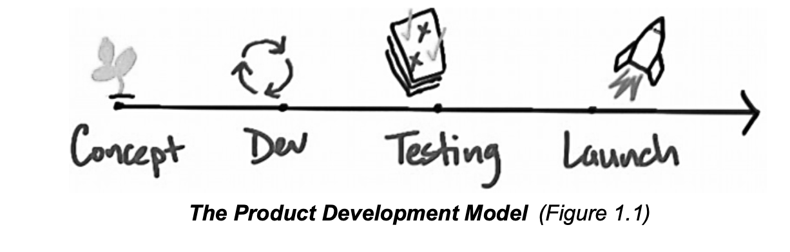
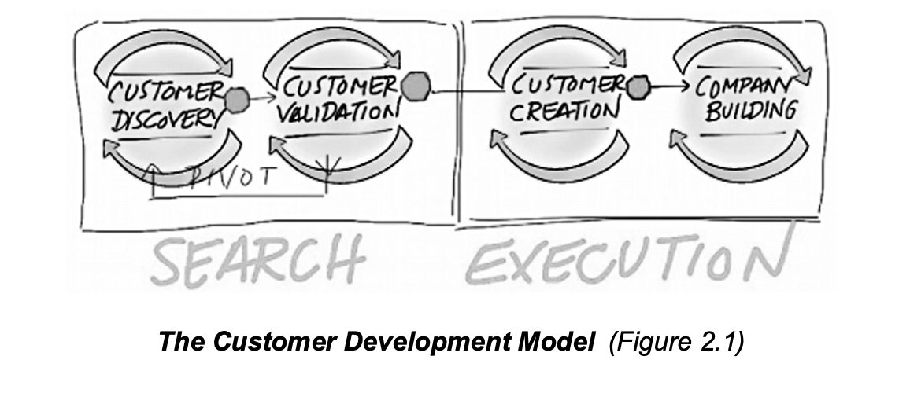

## Chapter One: The Path to Disaster

### The Product Development Model

The Product Development Model mapped out similarly to the one shown, is meant to help a company bring a new product into an existing market. This helps a company tailor the Product Development activities—the steps involved in bringing a product from concept or idea through market release—they do this through successive refinements to the product based on customer and market requirements. And they are doing this within a known competitive environment.

This traditional model orients itself on "first customer ship date," and is a linear process, moving from one step to the next, this forces sales and marketing to work backwards from a pre-determined release date, which by then is too late for the startup to discover that their early customers don't scale into a mainstream market. This happens because this model also fails to establish any meaningful milestones for non-engineering activities.

The meaning of requirements and specifications documents, implementation, and A/B Testing, and first customer ship are most obvious to engineering teams. Conversely, Sales and Marketing activities before first customer ship are absent any measurable, concrete activities, lacking any ways to stop and fix what's broken. If they have set in place any means to discover what is broken, or how to stop it at all.

### Problems With the Product Development Model

1. **Where are the Customers?**

   The failure of startups can be attributed to the lack of customer and market development. Not a lack of a product.

2. **The Focus on First Customer Ship**

   The first customer ship date does not mean the company understands its customers or how to market or sell to them.

3. **An Emphasis on Execution Instead of Learning and Discovery**
4. **Sales and marketing activities before first customer ship are ad hoc, fuzzy, and absent measurable, concrete objectives. They lack any way to stop and fix what's broken.**

The Product Development Model focuses on building and shipping, not on the process of Customer Development.

### Not All Startups Are Alike

1. Bringing a new product into an existing market
2. Bringing a new product into a new market
3. Bringing a new product into an existing market and trying to resegement that market as a low-cost alternative
4. Bringing a new product into an existing market and trying to resegment that market as a niche entrant

## Chapter Two: The Path to Epiphany

### The Customer Development Model

The Customer Development Model helps a startup learn about and discover who their initial customers will be, and what markets they are in. This requires a separate and distinct process from Product Development. This model is split into two parts, one part: Search and, one part: Execution. Its goal is to eventually synchronize a startup's Product Development and Customer Development processes.

#### The First Part

Customer Discover and Customer Validation, part of our Search process is focused on the testing and development of a business model. This ensures that a company does not build its Non-Product Development teams (sales, market, business development) until it has proof in hand that it has a valid business model.

#### The Second Part

Customer Creation and Company Building, part of the Execution process is focused on taking what we learned in our Search process and creating and driving end-user demand. From this, the company is now able to transition the organization to one that can execute on the ideas produced from its learnings.

### The Four Steps To The Epiphany

**Customer Discovery** focuses on testing whether a company's business model is correct, specifically focused on whether the product solves customer problems and needs. **Customer Validation** develops a sales model that can be replicated. **Customer Creation** creates and drives end-user demand, and **Company Building** transitions the organization from one designed for learning and discovery to a well-oiled machine engineered for execution.

#### Step One: Customer Discovery

**It's Goal:** finding out who your customers are and if the problem you are solving for them is important to them.

**To do this:** leave guesswork behind and get "outside the building" in order to learn what the high-value customer problems are, what about your product solves those problems, and who specifically are your customer and user.

**The Customer Development Team:** The job of this team is to see whether there are customers and a market for your founding vision. The initial product specification comes from the founder's vision, not the sum of a set of focus groups. \*\*\*\*

#### Step Two: Customer Validation

**The Goal:** Build a repeatable sales loop for the sales and marketing teams that they will follow later.

**What it proves:** Customer Validation proves you have found a set of customers and a market that react positively to the product.

**When to move to the next step?** If and only if, you find a group of repeatable customers with a repeatable sales process, and then find that those customers yield a profitable business model.

> 💡 **Customer Discovery** and **Customer Validation** corroborate your business model.

#### Step Three: Customer Creation

**The Goal:** Create end-user demand and drive that demand into the company's sales channel**.** Note that this process varies with the type of startup.

This step is placed after Customer Validation to move heavy marketing spending after the point where a startup acquires it first customers, thus allowing the company to control its cash-burn rate.

#### Step Four: Company Building

**This is the step where** the company transitions from its informal, learning and discovery-oriented Customer Development team into formal departments with VPs of Sales, Marketing and Business Development.

The executives focus on building mission-oriented departments exploiting the company's early market success.

### The Four Types Of Startup Markets

**Failure of a startup is not due to lack of energy, effort or passion.** It may simply be not understanding there are four types of startup markets:

#### Startups that want to re-segment an existing market as a low-cost entrant

Low cost re-segmentation, looks at an existing market and asks: are there customers at the low-end of an existing market whole will buy "good enough" performance if they could get it at a substantially lower price?

#### Startups that want to re-segment an existing market as a niche player

Niche re-segmentation, looks at an existing market and asks: Can we convince customers that some characteristics of our new product is enough to change the rules and shape of an existing market?

#### Startups that are entering an existing market

You are in an existing market if your product offers higher performance than what is currently offered.

**Good News:** The users and the market are known, but so are the competitors.

**Bad News:** Competitors define the market. The basis of competition is all about the product and product features.

#### Startups that are creating and entirely new market

A new market results when a company creates a large customer base that couldn't do something before.

**Good News:** Your product features are at first irrelevant because there are no competitors.

**Bad News:** The users and the market are undefined and unknown.

Creating a new market requires you to understand whether there is a large customer base that couldn't do this before, whether these customers they want or need your new product, and whether customer adoption occurs in your lifetime. It also requires sophisticated thinking about financing—how you manage the cash-burn rate during the adoption phase, and how you manage and find investors who are patient and have deep pockets.

#### Startup Market Type

One of the most important considerations to make as a startup is where you're trying to fit yourself into the market. As a company follow the Customer Development process the importance of Market Type will grow, the pace at which you move through the process also depends largely on it. The table below sums up the differences among market types.

- A startup that wants to bring a new product into an existing market, or a new product to a new market. Apple and Facebook are examples of two companies that have done this very successfully.
- A startup that wants to re-segment a market, either as a low-cost entrant or as a niche player. Disney+ is an example of the latter, coming into streaming media with a price of $6.99/month.

|             | Existing Market     | Resegmented Market                                                 | New Market                                                   |
| ----------- | ------------------- | ------------------------------------------------------------------ | ------------------------------------------------------------ |
| Customers   | Existing            | Existing                                                           | New/New usage                                                |
| Customer Needs | Performance      | 1. Cost 2. Perceived need                                       | Simplicity & convenience                                     |
| Performance | Better/faster       | 1. Good enough at the low end 2. Good enough for new niche      | Low in "traditional attributes", improved by new customer metrics |
| Competition | Existing incumbents | Existing incumbents                                                | Non-consumption / other startups                             |
| Risks       | Existing incumbents | 1. Existing incumbents 2. Niche strategy fails                  | Market adoption                                              |

> 💡 As a company follows the Customer Development process the importance of Market Type grows in each step.

### Synchronizing Product Development and Customer Development

Customer Development and Product Development are parallel processes. While the Customer Development group is engaged in _customer centric_ activities outside the building, the Product Development is focused on the _product centric_ activities taking place internally.

The goal of Customer Development in a startup is to find a market for the product as spec'd, not to develop or refine a spec based on a market that is unknown.

In each step [of the epiphany] the Product Development and Customer Development teams hold a series of formal synchronization meetings. **Unless the two groups agree, Customer Development does not move forward to the next step.**

- Customer Discovery:
  The Customer Development team strives to validate the product spec, not come up with a new sets of features. - Only if customers do not agree that the product as spec'd solves any problem, do the CD and PD teams reconvene to add or refine features. - Also, when customers have consistently said that new or modified product features are required, the VP of Product Development goes out with the team to listen to customer feedback before new features are added.
- In Customer Development, key members of the PD team go out in front of customers as part of the pre-sales support team.
- In Company Building, the PD team does installations and support for initial product while training the support and service staff.

> 💡 Two things to note:
>
> One: For a startup to succeed, Product and Customer Development must remain synchronized and operate in concert.
>
> Two: While each step has its own specific objectives, the process as a whole has one overarching goal: proving there is a profitable scalable business for the company.

## Chapter Three: Customer Discovery

Most startups understand how to build a product and how to measure the progress toward the product ship date. But without a set of early Customer Development goals it is impossible to measure progress in understanding customers and finding a market for your product.

**Those goals can be achieved by answering these four questions:**

1. Have we identified a problem a customer wants solved?
2. Does our product solve these customer needs?
3. If so, do we have a viable and profitable business model?
4. Have we learned enough to go out and sell?

### The Customer Discovery Philosophy

A startup begins with a vision. But most of what a startup's founders initially believe about their market and potential customers are just educated guesses.

**The goal of Customer Discovery** is to turn the founders' initial hypotheses about their business model, market and customers into facts.

Instead of doing these things:

- Understand the needs and wants of all customers
- Make a list of all features customers want before they buy your product
- Hand product development a features list of the sum of all customer requests
- Hand product development a detailed market requirements document

You are going to develop your product iteratively and incrementally for the few not the many. In a startup the rules marketers learn about product management are turned upside down. In a startup, the first product is not designed to satisfy a mainstream customer.

#### The Most Important Customer

The "Earlyvangelist" is the type of customer willing to take a risk on your startup's product or service, they can envision its potential to solve a critical and immediate problem. Unfortunately most customers don't fit this profile.

They are identified as a customer who:

1. Has a problem.
2. Understands that they have a problem.
3. Are actively searching for a solution and has a timetable for finding it.
4. Has a problem painful enough for them to have cobbled together an interim solution.
5. Has committed, or can quickly acquire, budget dollars to solve the problem.

#### Start Development Based on the Vision

A startup builds its product for a small group of initial customers, and builds the product iteratively. On day one there is very little customer input on the initial specification and you won't know who your initial customers are or what they will want as features. Nevertheless, stay productive, proceed with Product Development, with the feature list driven by the vision and experience of the company's founders. The customer development model will have your founding team take the product as spec'd and search for customers, tailoring the first release of the product to satisfy their needs.

Have productive Customer Development/Product Development team synchronization meetings will ensure that once key customer information becomes available, it is integrated into the product's future development.

#### Overview of the Customer Discovery Process

##### Phase One

Phase 1 is a rigorous process of writing a series of briefs that capture the hypotheses embodied in your company's vision and business model.

These are the assumptions about your product, customers, pricing, demand, market, and competition.

##### Phase Two

In phase 2, you qualify those assumptions by testing them in front of potential customers.

**The Goal:** Arrive at an understanding about your customers and their problems, and if selling to a business: A deep understanding of their business, workflow, organization, and product needs.

**Before the next step:** Take all that you've learned, integrate it, update Engineering with customer feedback, and jointly revise your product and customer briefs.

##### Phase Three

In phase 3, take your revised product concept and test its features in front of customers.

**The goal** is not to sell the product but to validate the hypotheses about it by having customers say: "Yes, these features solve our problems."

**At the same time** you've been testing the product features you've also been testing the validity of your entire business model. A valid business model consists of customers who place a high value on your solution, and find the solution you offer is: (for a company): Mission Critical, (for a consumer): "Have-to-have".

##### Phase Four

In phase 4, **stop** and verify:

- that you understand your customers' problems
- that the product solves those problems
- that customers will pay for the product
- and that the resulting revenue will sustain a profitable business model

This phase culminates in the **deliverables** for the **Customer Discovery** step:

1. A problem statement document
2. Expanded product requirement document
3. An updated sales and revenue plan
4. A second business and product plan.

**If and only if,** you are successful in this step do you proceed to **Customer Validation.**

## The Customer Development Team

At first this team may consist of the company's technical founder who moves out to talk with customers while the other engineers build the product. But whether a single individual or a team, CD must have the authority to radically change the company's direction [know when to pivot]. To succeed in this process the team members must possess:

- The ability to listen to customer objections and understand whether they are issues about the product, the presentation, the pricing, or something else.
- Experience moving between the CD and PD team
- The ability to embrace constant change
- The capacity to put themselves in the customers' shoes, understand how they work and what problems they have.

This team is complemented by the startup's product execution team, often headed by the product visionary who leads the development effort.

**There is a phase 0** to the Customer Discovery process: "Get(ting) buy-in". Getting buy-in from all the key players on several fundamentals. The customer development process, the company's mission, and it's core values.

Customer Development as a separate process from Product Development is a new concept. You must get all the key players educated; get their agreement about the process, key hires, and values. Make sure that they understand the differences between Product Development, Customer Development and Market Type and that they buy into the value of differentiating between them.

**The Product Development process** emphasizes execution.

**The Customer Development process** emphasizes learning, discovery, failure, iterations and pivots.

You want to articulate in writing both the business and product vision of why you started the company: "What we were thinking when we were out raising money" Write these down and post them to the wall. In times of crisis or confusion, understanding why the company exists and what its goals are will provide a welcome beacon of clarity.

Finally, next to the mission statement post the founding team's core values: A set of fundamental beliefs about what the company stands for that can endure the test of time. (For them to be useful, a maximum of three to five should be articulated)

### Phase 1: State your Hypothesis

**The Goal:** Get down what you know (or assume you know) on paper and create a template to record new information you will discover.

The next phase of the Customer Discovery Process involves writing down all of your company's initial assumptions, or hypotheses. This takes the form of a brief one- or two-page brief about each of the following:

**Your product hypothesis** consists of the founding team's initial guess about the product and its development.

**At the end,** when all of the six hypotheses are written down. Paste this brief to the wall. Soon it will be joined by a few more. Soon after, you will be in front of customers testing these assumptions.

#### First Product Development/Customer Development Synchronization Meeting

The goal of the first meeting will be getting your product hypotheses down on paper and turning them into a product brief, agreed to by all executives, and is essential for the Customer Development team to begin its job.

The Product Brief will cover:

- Product Features
- Product Benefits
- Intellectual Property
- Dependency Analysis
- Product Delivery Schedule
- Total cost of ownership/adoption

#### Product Hypothesis: Product Features

The Product Features list is a one-age document consisting of one- or two-sentence summaries of the top-10 (or fewer) features of the product. The biggest challenge will be timing the shipment of each feature.

#### Product Hypothesis: Product Benefits

The benefits list describes what benefits the product will deliver to customers. The Customer Development model recognizes that Marketing doesn't know anything about customers yet. In a startup Product Development has all kinds of customer "facts": Use this meeting to flush these out.

#### Product Hypothesis: Intellectual Property

In this part of the brief, the product team provides a concise summary of assumptions and questions about intellectual property. The expense of securing any patents is prohibitive, taking an active patent position is prudent and patents can be a major financial asset for the company.

#### Product Hypothesis: Dependency Analysis

The Product and Customer Development teams jointly prepare a one-page document stating: "For us to be successful, here's what has to happen that is out of our control." For each factor, the dependency analysis specifies what needs to happen, when it needs to happen, and what it means for you if it doesn't happen. Also, write down how you can measure whether each external change is happening when you need it to.

#### Product Hypothesis: Product Delivery Schedule

In the product delivery schedule, you ask the product team to specify not only the date of the first release, but the delivery and features schedule for follow-on products or multiple releases of the product as far out as the team can see. This will be important in order for the Customer Development team because they will be out trying to convince a small groups of customers to buy based on the product spec long before you can physically deliver the product.

#### Product Hypothesis: Total Cost of Ownership/Adoption

The total cost of ownership (TCO) adoption analysis estimates the total cost to customers of buying and using your product.

**For Business Products** this involves asking different questions than for **consumer products.**

While the Customer Development team prepares this estimate, the Product Development team should provide feedback about whether the estimates are realistic.

Watch: [Steve Blank on "Don't Waste A Good Crisis" (The NFX Podcast)](https://www.youtube.com/watch?v=agODxEd43Q0)
