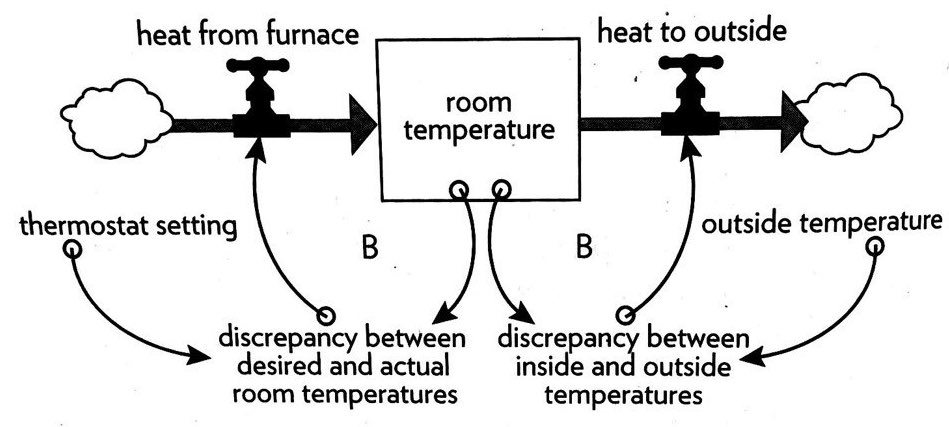
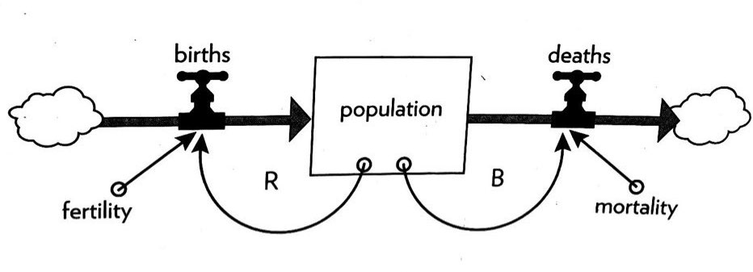
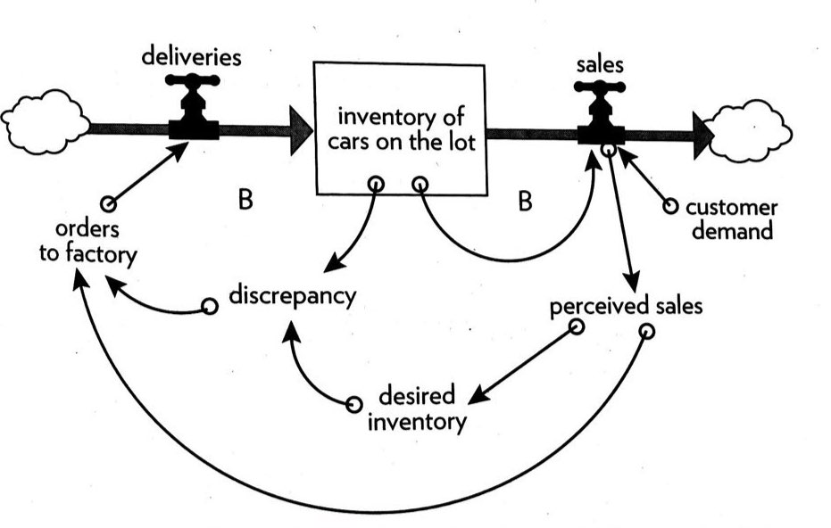
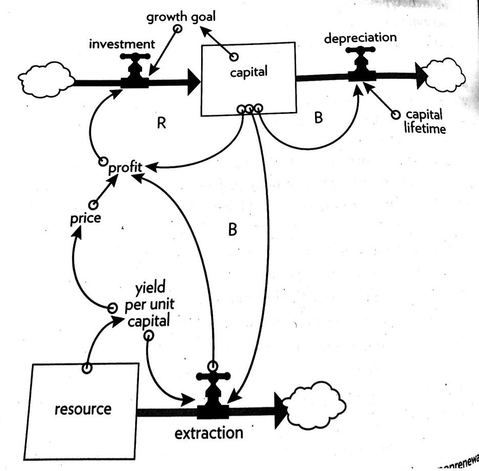
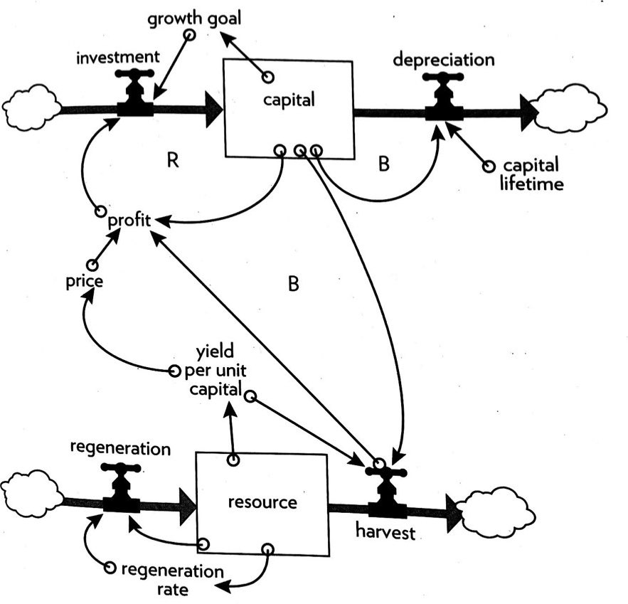

**“You think because you understand 'one' you must also understand 'two', because one and one make two. But you must also understand 'and'.”**
— Mawlana Jalal-al-Din Rumi

**“In theory, there is no difference between practice and theory. In practice, there is.”**
— Yogi Berra

## Chapter One: The Basics

### Parts of a System

- **Stock:**
  - Elements of the system that are observable
- **Interconnections:**
  - Many of the interconnections in systems operate through the flow of information.
  - Information holds systems together and plays a great role in determining how they operate.
- **Purpose:**
  - The least obvious part of a system, it's function \*_or purpose_,\* is often the most crucial determinant of a system's behavior.

> Systems thinkers use graphs of behavior over time to understand trends over time rather than focusing on individual events

### Real World Example–Jubilee Roasting Co.

**Elements →**

Their employees, customers, and products.

**Interconnections →**

**\*(** The relations that hold elements together )\*

The local community / other cafés. it's revenue streams, technology, marketing and the ecosystem

**Purpose →**

Support the local economy, provide a place where members of the community can gather and do work.

> A system is more than the sum of its parts. It may exhibit adaptive, dynamic, self-preserving, and sometimes evolutionary behavior.

### How the System Runs Itself - _Feedback_

If you see a behavior that persists over time, there is likely a mechanism creating that consistent behavior; That mechanism operates through a **Feedback Loop*.***

#### Stabilizing Loops - Balancing Feedback

Balancing feedback loops are "_Goal-Seeking_" or "_Stability Seeking_". \*\*Each tries to keep a stock at a given value or within a range of values.

#### Runaway Loops - Reinforcing Feedback

Reinforcing loops can be found wherever a system element has the ability to reproduce itself or to grow as a constant fraction of itself. (Populations and Economies)

A **_Feedback Loop_** is a closed chain of causal connections from a stock, through a set of decisions or rules or physical laws or actions that are dependent on the level of the stock and back again through a flow to change the stock

> Reinforcing Feedback Loops are self-enhancing, leading to exponential growth or to runaway collapses over time.

## Chapter Two: A Brief Visit to the Systems Zoo

### One Stock Systems

#### A Stock with Two Competing Balancing Feedback Loops — A Thermostat

> The information delivered by a feedback loop—even non physical feedback—can only affect future behavior; it cannot deliver a signal fast enough to correct behavior that drove the current feedback.

#### A Stock with One Reinforcing Loop and One Balancing Loop — Population and Industrial Economy

> Complex behaviors of systems arise as the relative strengths of feedback loops shift, causing first on loop and then another to dominate behavior

> ❔ Questions for testing the value of a model
>
> 1. Are the driving factors likely to unfold this way?
> 2. If they did, would the system react this way?
> 3. What is driving the driving factors?

#### A System with Delays — Business Inventory

> A delay in a balancing feedback loop makes a system likely to oscilate.

\*\* Changing the length of a delay may or may not make a large change in the behavior of a system

### Two Stock Systems

#### A Renewable Stock Constrained by a Nonrenewable Stock — An Oil Economy

> In physical, exponentially growing systems, there must be at least one reinforcing loop driving the growth and at least one balancing loop constraining the growth. **_Because no physical system can grow forever in a finite environment._**

#### A Renewable Stock Constrained by a Renewable Stock—A Fishing Economy

- **Nonrenewable resources are stock limited**
- **Renewable resources are flow limited**

\*\* Depending on the type of the delay and the relative lengths of other delays

## Chapter Three: Why Systems Work So Well

Why do systems work so well? Consider the functions of highly functional Systems:

**Machines**

**Human Communities**

**Ecosystems**

### Resilience

- Resilience has many different definitions depending on the branch of engineering, ecology, or system science doing the defining.

**Resilience** arises from a rich structure of many feedback loops that can work in different ways to restore a system even after a large perturbation. Resilient systems can be very dynamic, and conversely, systems that are constant over time can be brittle. And, resilience is not the same thing as being static or constant over time.

**The distinction between _static stability_ and _resilience_ is important:**

- **_Static Stability →_** is something you can see; it's measured by variations in the condition of a system week by week or year by year
- **_Resilience →_** is something that may be very hard to see, unless you exceed its limits.

> There are always limits to resilience

Systems need to be managed not only for productivity and stability, but also for resilience. Awareness of resilience enables one to see many ways to preserve or enhance a system's own restorative powers.

### Self-Organization

- Self-organization is the capacity of a system to make its own structure more complex
- It is often sacrificed for purposes of short-term productivity and stability
- And, it requires freedom and experimentation, and a certain amount of disorder within the system.

These conditions that encourage self-organization often can be scary for individuals an threatening to power structures. Self-organization is such a basic property of living systems that even the most over-bearing power structure can never fully kill it.

### Hierarchy

- In the process of creating new structures and increasing complexity, one thing that a self-organizing system often generates is hierarchy.

Hierarchies are brilliant systems inventions, not only because the give a system stability and resilience, but also because they reduce the amount of information that any part of the system has to keep track of.

When a subsystem's goals dominate at the expense of the total system's goals, the resulting behavior is called sub-optimization.

> Hierarchical systems evolve from the bottom up. The purpose of the upper layers of the hierarchy is to serve the purposes of the lower layers.

## Chapter Four: Why Systems Surprise Us

And, they remind us of three truths:

1. Everything we think we know about the world is a model.
2. Our models usually have a strong congruence with the world.
3. However, our models fall short of representing the real world.

You are likely to mistreat, misdesign or misread systems if you don't respect their properties of resilience, self-organization and, hierarchy.

You can navigate well in an interconnected, feedback dominated world unless you take your eyes off of short-term events and look for long-term behavior and structure.

> The interactions between what one knows about dynamic systems and what one experiences of the real world can be humbling.

### Beguiling Events

- Systems fool us by presenting themselves as a series of events. We are less likely to be surprised if we can see how events accumulate into dynamic patterns of behaviors.

Systems thinking goes back and forth constantly between structure and behavior.

**Structure →** Diagrams of stocks, flows and behavior. \*\*\*\*

**Behavior →** Time graphs

**Problems with behavior-based models:**

→ They overemphasize system flows and under emphasize stocks.

→ Trying to find statistical links that relate flows to each other is difficult.

> System structure is the source of system behavior. System behavior reveals itself as a series of events over time.

### Linear Minds in a Nonlinear World

**Linear Relationship →** A relationship between two elements in a system that has constant proportion between cause and effect

**Nonlinear Relationship →** A relationship between two elements in a system where the cause does not produce a proportional effect

- Non-linearity can flip a system from one mode of behavior to another, and change the relative strengths of feedback loops.

### Nonexistent Boundaries

It's a great art to know that boundaries our of own [creation], and that they can and should be reconsidered for each new discussion, problem or purpose.

> There are no separate systems. The world is a continuum. Where to draw a boundary around a systems depends on the purposes of the discussion.

#### Layers of Limits

**Limiting Factor →** A necessary system input that is the one limiting the activity of the system at a particular moment.

There will always be limits to growth. If they are not self-imposed they will be system-imposed.

> Any physical entity with multiple inputs and outputs is surrounded by layers of limits. **_No physical entity can grow forever._**

### Ubiquitous Delays

**We are surprised over and over again at how long things take.** Every stock is a delay and most flows have delays.

For Example,

- The delay between catching an infectious disease and getting sick enough to be diagnosed.

> When there are long delays in feedback-loops some sort of foresight is essential.

### Bounded Rationality

**Bounded Rationality** is the _logic_ that leads to decisions or actions that make sense within one part of a system but are not reasonable within a broader context or when seen as part of the wider system.

Change comes from first stepping outside the limited information that can be seen from any single place in the system and getting an overview [of the system as a whole].

> The bounded rationality of each actor in a system may not lead to decisions that further the welfare of the system as a whole.

## Chapter Five: System Traps... and Opportunities

Delays, nonlinearities, lack of firm boundaries, and other properties of systems that surprise us are found in just about any system. But, some systems are more than _surprising_ they are _perverse._ These are the systems that are structured in ways that produce truly problematic behavior. We call these patterns **Archetypes.**

**Archetypes** are common system structures that produce characteristic patterns of behaviors.

### The Trap: Policy Resistance

When various actors try to pull a system stock toward various goals, the result can be policy resistance. Any new policy, especially if it's effective, just pulls the stock further from the goals of the other actors—producing additional resistance, ending up with a result that no one likes but that everyone expends considerable effort in maintaining.

#### The Way Out

**Let go.** Bring in all the actors and transfer the energy expended on resistance to seeking out mutually satisfactory ways for all goals to be realized.

### The Trap: Tragedy of the Commons

When there is a commonly shared resource, every user benefits directly from its use, but share the costs of its abuse with everyone else... The consequence is overuse of the resource, eroding it until it becomes unavailable to anyone.

#### The Way Out

Educate and exhort the user so they understand the consequence of abusing the resource.

### The Trap: Drift to Low Performance

Allowing performance standards to be influenced by past performance, especially if there is a negative bias in perceiving past performance, sets up a reinforcing feedback loop of eroding goals that sets a system drifting towards low performance.

#### The Way Out

Keep performance standards absolute. **Even better**, let standards be enhanced by best actual performances instead of being discouraged by the worst.

### The Trap: Escalation

When the state of one stock is determined by trying to surpass the state of another stock–-and vice versa. generating a reinforcing feedback loop carrying the system into an exponentially growing escalation. If nothing is done, the spiral will be stopped by some things collapse–because exponential growth cannot go on forever.

#### The Way Out

The best way out of this trap, is to avoid getting into it. If caught in an escalating system one can refuse to compete, thereby interrupting the reinforcing loop. Or, one can negotiate a new system with balancing loops to control the escalation.

### The Trap: Success to the Successful—"The Rich Get Richer"

If the winners of a competition are systematically rewarded with the means to win again. A reinforcing feedback loop is created by which if it is allowed to proceed uninhibited, the winners eventually take all.

#### The Way Out

**Diversification**, which allows those who are losing the competition to get out of that game and start another one. Strict limitation on the fraction of the pie any one winner may win; policies that level the playing field, removing some of the advantage of the weakest; policies that devise rewards for success that do not bias the next round of competition.

### The Trap: Shifting the burden to the intervenor

Shifting the burden, dependence and addiction arise when a solution to a systemic problem reduces (or disguises) the symptoms, but does nothing to solve the underlying problem.

#### The Way out

**The best way to get out of this trap is to not get into it.** Beware of symptom relieving or signal-denying policies or pressures that don't really address the problem. Take the focus off short-term relief and put it on long-term restructuring.

### The Trap: Rule Beating

Rules to govern a system can lead to rule-beating—perverse behavior that gives the appearance of obeying the rules or achieving the goals but that actually distorts the system.

#### The Way Out

Design or redesign rules to release creativity not in the direction of beating the rules, but in the direction of achieving the purpose of the rules.

### The Trap: Seeking the Wrong Goal

System behavior is particularly sensitive to the goals of feedback loops. If the goals—the indicators of satisfaction of the rules—are defined inaccurately or incompletely, the system may obediently work to produce a result that is not really intended or wanted.

#### The Way Out

Specify indicators and systems that reflect the real welfare of the system. Be especially careful not to confuse effort with result or you will end up with a system that is producing effort, **not result.**

## Chapter Six: Leverage Points—Places to Intervene in a System

- How do we change the structure of systems to produce more of what we want and less of that which is undesirable?

Jay Forrester, a researcher at MIT says that the average manager can define well, a problem, Identify in the system structure where it is, and guess with great accuracy where to look for leverage points. He also points out that although people deeply involved in a system can know intuitively where to find leverage points, more often than not they push the change in the wrong direction. _Counterintuitive_ is how he describes complex systems.

As systems become complex, their behavior can become surprising.

Donella H. Meadows, compiled a list of twelve leverage points, but she does warn that leverage points are often not intuitive. Of the twelve, I chose three to take notes on.

### 3. Goals: The Purpose of the System

The diversity-destroying consequence of the push for control demonstrates why the goal of a system is a leverage point superior to the selff-organizing ability of a system.

### 2. Paradigms: The mind-set out of which the system—its goals, structure, rules, delays, and parameters—arises

Paradigms are the sources of systems. From them, from shared social agreements about the nature of reality. Come system goals and information flows, feedback, stock, flows, and everything else about systems.

**How do you change paradigms?** Systems modelers say that we can change paradigms by building a model of the system, which takes us outside of the system and forces us to see it whole.

### 1. Transcending Paradigms

Transcending paradigms is to keep oneself unattached in the arena of paradigms, to stay flexible, to realizing the _no_ paradigm is "true", that every one, including the one that shapes your worldview, is a tremendously limited understanding of an immense and amazing universe that is far beyond human comprehension.

It is in this space of mastery over paradigms that people overcome addictions, live in constant joy, bring down empires, get locked up or burned at the stake or crucified or short, and have impacts that last for millennia.

## Chapter Seven: Living in a World of Systems

1. Get the beat of the systems
   - Before you disturb the system in any way. **_Watch how it behaves, learn it's history, and learn from others who have interacted with the system over a significant period of its life cycle._**
2. Expose your mental models to the light of day
   - Getting models out in the light of day, making them as rigorous as possible, testing them against evidence, and being willing to scuttle them if they are no longer supported is nothing more than practicing the scientific method.
3. Honor, Respect and Distribute Information
   - **Information holds systems together**
   - Decision makers can't make good decisions if information is untimely or inaccurate
   - Use language with care and enrich it with Systems Concepts
     - Our information streams are composed primarily of language
     - Honoring information means above all, _avoiding language pollution_
     - It also means expanding our language so we can talk about complexity

- Pay attention to what is important, not just what is quantifiable
- Make feedback policies for feedback systems
- **Go for the good of the whole**
- Listen to the wisdom of the system
- Locate responsibility in the system
- **Stay Humble - Stay a Learner**
- Celebrate complexity
- Expand the horizons
- Defy the disciplines
- Expand the boundary of caring
- **Don't erode the Goal of Goodness**

## System Definitions: A Glossary

**Agency** → The capacity of an actor to act in a given environment.

**Agency Dilemma** → _See_ Principle-Agent Problem

**Archetypes →** Common system structures that produce characteristic patterns of behavior

**Entropy (Order and Disorder)** → Designates the presence or absence of some symmetry or correlation in a system

**Feedback Loop →** The mechanism (rule or information flow or signal) that allows a change in a stock to affect a flow into or out of that same stock

**Balancing Feedback Loop →** A stabilizing, goal-seeking, regulating feedback loop. Also called a "_negative feedback loop_" because it opposes, or reverses whatever change is imposed on a system

**Reinforcing Feedback Loop →** An amplifying or enhancing feedback loop. Also known as a "_positive feedback loop_" because it reinforces the direction of change

**Bounded Rationality →** The logic that leads to decisions or actions that make sense within one part of a system but are not reasonable within a broader context or when seen asa part of the wiser system
**Dynamic Equilibrium →** The condition in which the state of a stock is steady and unchanging, despite inflows and outflows. This is possible only when all inflows equal all outflows

**Dynamics →** The behavior over time of a systems or any of it's components

**Flow →** Material or information that enters or leaves a stock over a period of time

**Hierarchy →** Systems organized in such a way as to create a larger system

**Limiting Factor →** A necessary system input that is the one limiting the activity of the system at a particular moment

**Linear Relationship →** A relationship between two elements in a system that has constant proportion between cause and effect and so can be drawn in a straight line on a graph

**Nonlinear Relationship →** A relationship between two elements in a systems where the cause does not produce a proportional effect. \*\*\*\*

**Principle-Agent Problem →** A conflict in priorities between a person or group and the representative authorized to act on their behalf.

**Resilience →** The ability of a system to recover from perturbation; the ability to restore or repair or bounce back after a change due to an outside force.

**Self-organization →** The ability of a system to structure itself, to create new structure, to learn, or diversify

**Shifting Dominance →** The change over time of the relative strengths of competing feedback loops

**Stock →** An accumulation of material or information that has built up in a system over time

**Sub-optimization →** The behavior resulting from a subsystems goals dominating at the expense of the total systems goals

**System →** A set of elements or parts that is coherently organized and interconnected in a pattern or structure that produces a characteristic set of behaviors. Often classified as its "function" or "purpose"

## Summary of Systems Principles

### Systems

- A system is more than the sum of its parts.
- Many of the interconnections in systems operate through the flow of information.
- the least obvious part of the system, its _function_ or _purpose,_ is often the most crucial determinant of the system's behavior.
- System structure is the source of system behavior. System behavior reveals itself as a series of events over time.

### Stocks, Flows, and Dynamic Equilibrium

- A stock is the memory of the history of changing flows within the system.
- If the sum of inflows exceeds the sum of outflows, the stock level will rise.
- If the sum of all outflows exceeds the sum of inflows, that stock level will fall.
- If the sum of outflows equals the sum of inflows, the stock level will not change — it will be held in dynamic equilibrium.
- A stock can be increased by decreasing its outflow rate as well as by increasing its inflow rate.
- Stocks act as delays or buffers or shock absorbers in systems.
- Stocks allow inflows and outflows to be de-coupled and independent.

### Shifting Dominance, Delays, and Oscilations

- Complex behaviors of systems often arise as the relative strengths of feedback loops shift, causing first one loop and then another to dominate behavior
- A delay in a balancing feedback loop makes a system likely to oscillate
- Changing the length of a delay may make a large change in the behavior of a system

### Scenarios and Testing Models

- System dynamics models explore possible futures and ask "what if" questions
- Model utility depends not on whether its driving scenarios are realistic, but on whether it responds to a realistic pattern of behavior

### Constraints on Systems

- In physical, exponentially growing systems, there must be at least one reinforcing loop driving the growth **_and_** at least one balancing loop constraining the growth, because no system can grow forever in a finite environment
- **Nonrenewable resources are _stock-limited_**
- **Renewable resources are _flow-limited_**

### Resilience, Self-Organization, and Hierarchy

- There are always limits to _Resilience_
- Systems need to managed not only for productivity or stability, they also need to be managed for resilience.
- Systems often have the property of self-organization—the ability to structure themselves, to create new structure, to learn, diversify, and complexify
- Hierarchical systems evolve from the bottom up. The purpose of the upper layers of the hierarchy is to serve the purposes of the lower layers.

### Source of System Surprises

- Many relationships in systems are nonlinear
- There are no separate systems. The world is a continuum. Where to draw a boundary around a system depends on the purpose of the discussion.
- At any given time, the input that is most important to a system is the one that is most limiting
- Any physical entity with multiple inputs and outputs is surrounded by layers of limits
- There always will be limits to growth
- A quantity growing exponentially toward a limit reaches that limit in a surprisingly short time
- When there are long delays in feedback loops, some sort of foresight is essential
- The bounded rationality of each actor in a system may not lead to decisions that further the welfare of the system as a whole.

### Mindsets and Models

- Everything we think we know about this world is a model
- Our models do have a strong congruence with the world
- Our models fall far short or representing the real world fully.
